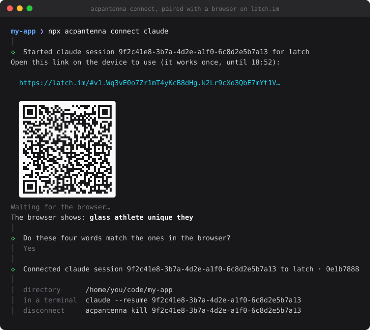
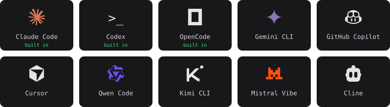

# acpantenna

**An ngrok for your coding agent.** One command gives Claude Code, Codex, OpenCode, or any [ACP](https://agentclientprotocol.com) agent a link and a QR code. Open it on your phone, or any browser, and the session you started at your desk carries on there, end-to-end encrypted.

<p align="center"></p>

- **Your session, not a new one.** Connect the session you are working in and pick up mid-conversation. Back at your desk, `claude --resume` shows everything said in the browser.
- **Your account.** Claude Code and Codex run through their official ACP adapters, and OpenCode as itself, on the subscription or key you are logged in with.
- **End-to-end encrypted.** The browser and your machine agree on keys through the link; the relay between them forwards ciphertext it cannot read.
- **Asks before it acts.** When the agent wants to run a command or edit a file, the browser asks you.
- **Nothing to set up.** The web client at [latch.im](https://latch.im) is built in. Matrix, Discord, a webhook, or a channel of your own are there when you want them.

## Quick start

You need Node 18 or newer on Linux, macOS or Windows (10 1803 or later), and the agent you want to connect, logged in (`claude`, `codex`). The package brings its own [Bun](https://bun.sh).

**1. Connect.** From the project directory:

```bash
npx acpantenna connect claude
```

That starts a new session; `--session-id <id>` connects the one you are in, and `--fork` a copy of it. Close the session in your terminal first, or fork it: two processes writing to one session drift apart.

**2. Open the link,** or scan the QR code, on the device you want to use. The link works once, for 10 minutes.

**3. Check the words.** The browser and your terminal both show four words. If they match, say yes in the terminal: only then does the browser get the session. Then:

```bash
npx acpantenna ls              # what is connected
npx acpantenna kill 9f2c       # disconnect (a unique prefix will do); the session itself is kept
```

## How it works

```
 latch.im ────┐                              ┌─ claude-agent-acp ─ Claude Code
 Matrix room ─┤                              ├─ codex-acp ─────── Codex
 webhook ─────┼─ channel ─ acpantenna ─ ACP ─┼─ opencode acp ──── OpenCode
 your own ────┘                              └─ any ACP agent
```

- A **channel** is where you talk to the agent. The built-in `latch` channel carries ACP itself, end to end encrypted, to the web client at latch.im. Chat channels such as Matrix turn a conversation into messages for acpantenna, and its replies, tool calls and questions back into the chat.
- An **agent** is any program that speaks the [Agent Client Protocol](https://agentclientprotocol.com) over stdio. Claude Code and Codex are reached through their official adapters (`@agentclientprotocol/claude-agent-acp`, `@agentclientprotocol/codex-acp`), pinned and fetched on first use. OpenCode speaks ACP itself: the `opencode` you have installed is used, so it is the same version as in your terminal, else a pinned `opencode-ai` is fetched.
- **`connect`** binds one conversation to one agent session and returns. The channels run in a background server, one per config, managed over a unix socket only you can reach. It stops when its last connection is dropped, and picks connections up again if it restarts — as it does when a newer `acpantenna` finds an older server running, and replaces it.

## Agents

<p align="center"></p>

Claude Code, Codex and OpenCode are built in: `connect claude`, `connect codex`, `connect opencode`. Any other agent that speaks ACP — these, and [the rest of the list](https://agentclientprotocol.com/overview/agents) — is one entry in your config, with the command its documentation gives for ACP:

```json
{ "agents": { "my-agent": { "command": "my-agent", "args": ["acp"] } } }
```

```bash
npx acpantenna connect my-agent
```

<sub>Logos from [Simple Icons](https://simpleicons.org) (CC0); they are trademarks of their owners, shown to say these agents speak ACP. Simple Icons has no OpenAI logo, so Codex has a plain mark.</sub>

## Channels

| Channel | |
| --- | --- |
| [latch.im](#latchim-the-built-in-channel) | Built in, and what `connect` uses unless told otherwise. A web client on any device, end-to-end encrypted through a relay; the browser is a full ACP client of the session, and acpantenna filters what it may do. |
| [Matrix](packages/channel-matrix/README.md) | Rooms on matrix.org or your own homeserver, end-to-end encrypted. Permissions answered with a reaction, replies streamed into one message, files the agent sends uploaded. |
| [Discord](packages/channel-discord/README.md) | Direct messages, server channels and threads. Permissions and questions answered with buttons (and a form), replies streamed into one message, files the agent sends uploaded. |
| [Telegram](packages/channel-telegram/README.md) | A bot from @BotFather, in a private chat, a group or a forum topic. Permissions answered with inline buttons, replies streamed into one message, files the agent sends uploaded. |
| Webhook | JSON in at `POST /channels/<id>/events`, replies at `GET /channels/<id>/outbox`. For local testing and simple integrations. |
| Relay | The same as latch.im, with a relay and web client of your own. |

`npx acpantenna setup` adds Matrix, Discord, Telegram or a webhook to your config. `npx acpantenna channels --json` describes every channel type and its settings. A channel is a small adapter on the channel SDK in [`packages/channel`](packages/channel/); the ones above show how to write one.

## latch.im, the built-in channel

The `latch` channel is in every config, first, so `connect` uses it unless you pass `--channel`. It carries the session's ACP itself to the web client at [latch.im](https://latch.im), rather than turning it into chat messages. The two meet through latch.im's relay, which only forwards ciphertext: Noise `NKpsk0`, with the keys in a one-time link. The open spec is [docs/relay-protocol.md](docs/relay-protocol.md); a session on the relay lasts up to an hour.

What the relay cannot hide is who connects, when, and roughly how much is sent; frames are padded to make that say less. The web page itself is served by latch.im and is not open source: whoever controls what latch.im serves could read the session in that browser, within what the filtering proxy below allows. To use a relay and web client of your own, change the channel, or turn it off and add a `relay` channel under another name:

```json
{ "channels": { "latch": { "relayUrl": "wss://relay.example", "webOrigin": "https://app.example" } } }
```

```json
{ "channels": { "latch": false } }
```

1. `connect` prints a link and its QR code, both made on your machine. The link works once and expires after 10 minutes.
2. Open it on the other device. Both screens show four words.
3. If they match, say so in the terminal. Only then does the browser get the session.

Until you confirm, the browser can do nothing; anyone else who opens the link after it can do nothing at all. `ls` shows the connection, and `kill` ends it and tells the browser. `revoke` gives the channel a new key, so no link it has given out works any more, and drops its connections. A browser that leaves ends the connection too: run `connect` again for a new link.

The browser is an ACP client of your agent, so acpantenna stands between them as a filtering proxy:

- Only the methods a chat needs are let through: `initialize`, `session/list`, `session/new`, `session/load`, `session/resume`, `session/prompt`, `session/cancel`, `session/set_mode` and `session/set_config_option`.
- The connection stays on its own session, in its own directory, with the MCP servers in your config: a directory or MCP server the browser sends is ignored.
- The agent's file and terminal requests are refused here and never reach the browser. "Always allow" is answered as "allow once".
- Streamed text is sent in batches on a fixed tick, and every frame is padded, so traffic says less about what is in it.

The channel's own X25519 key is kept in the OS keychain, or in its state directory where there is none (`keyStorage: "file"` keeps it there always). For development, `bun packages/channel-relay/src/dev-relay.ts` runs a relay on `ws://127.0.0.1:8787`.

## In a conversation

| You send | |
| --- | --- |
| a message | goes to the agent |
| `/cancel` | stops the turn in progress |
| `/new` | starts a fresh session for this conversation |
| `/mode <id>` | switches the session's mode, e.g. Claude Code's `plan` |

The agent can also write between turns, and its questions — a permission, a form — arrive as messages you answer in place.

## Commands

| Command | |
| --- | --- |
| `setup` | Add a channel to your config, or change one |
| `connect <agent>` | Connect an agent session to a conversation: `--session-id`, `--fork`, `--channel`, `--conversation`, `--cwd`, `--config`. With a relay channel, pair a browser |
| `ls` | List connections (`--json`) |
| `kill <session>` | Disconnect: by session id or prefix, `--conversation <id>`, or `--all` |
| `revoke` | Give relay channels (or `--channel`'s) a new key: every link they gave out stops working, and their connections are dropped |
| `serve` | Run the configured channels and agents in the foreground, as a long-lived gateway |
| `doctor` | Check a config and point out risky settings |
| `channels` | List configured channels; `--json` describes every channel type |
| `sessions` | List stored conversation-to-session mappings |
| `init` | Write a starter `acpantenna.config.ts` |

The config is `--config`, else `./acpantenna.config.ts` in the current directory, else the one `setup` wrote. Without any, there is the `latch` channel and the built-in agents.

## Configuration

You need none to start: `connect` uses the `latch` channel and the built-in agents. `setup` adds the others. For more, write the config yourself — JSON, or TypeScript with types:

```ts
import { defineConfig } from "@acpantenna/config";

export default defineConfig({
	agents: {
		claude: { preset: "claude" },
		mine: { command: "my-agent", args: ["acp"] },
	},
	channels: {
		matrix: {
			type: "matrix",
			agent: "claude",
			homeserverUrl: "https://matrix.org",
			userId: "@mybot:matrix.org",
			password: "${MATRIX_BOT_PASSWORD}",
			defaultConversation: "!room:matrix.org",
			permissions: {
				inbound: { mode: "allowlist", allow: ["@me:matrix.org"] },
				toolCalls: "ask",
			},
		},
	},
});
```

- `${VAR}` anywhere is read from the environment, so secrets need not be in the file.
- Every channel takes `agent`, `defaultConversation`, `session` (per conversation or per sender, idle timeout, rehydration), `permissions`, `delivery` (one message per turn, streamed, debounced, or raw events) and `intake`.
- `mcpServers` hands MCP servers to the agents' sessions.
- What a gateway remembers — which conversation talks to which session, a channel's own files such as the Matrix bot's keys — is kept per config under `~/.local/state/acpantenna/configs/` (`%LOCALAPPDATA%\acpantenna\configs\` on Windows; `XDG_STATE_HOME` and `ACPANTENNA_STATE_DIR` move it), unless `state` says otherwise.

## Security

- **Nobody is let in by default.** A chat channel answers only the senders and conversations on its allowlist; the web client, only the browser whose words you confirmed.
- **The agent asks.** With `toolCalls: "ask"` (what `setup` writes) every permission the agent requests is a question in the chat; the default, `deny`, refuses them all. Unanswered questions are refused after `interactionTimeoutSeconds`.
- **Local control only.** Connections are managed over a unix socket in a directory only you own, never over the network.
- **Secrets stay out of files.** `setup` keeps passwords and tokens in the OS keychain (Keychain on macOS, Credential Manager on Windows, the Secret Service on Linux); the config only names them, as `${keychain:<name>}`. Where there is no keychain they stay in the config, which is owner-only (0600; on Windows, inside your user profile). A hand-written config can also take secrets from the environment, as `${VAR}`.
- acpantenna offers the agent no file or terminal access of its own (ACP's client `fs` and `terminal` capabilities are off). What the agent can touch is what it can touch on its own, under its own permission rules.
- **A web client gets in only with your yes.** A relay link works once, for 10 minutes, and the browser is let in only after you confirm its four words in your terminal. It then reaches its session through a filtering proxy, not the agent itself.

## Telemetry

OpenTelemetry traces go out over OTLP when `OTEL_EXPORTER_OTLP_ENDPOINT` is set, or to stdout with `OTEL_TRACES_EXPORTER=console`. Otherwise nothing is exported. Logs go to stderr.

## Development

acpantenna is a Bun workspace:

| Package | |
| --- | --- |
| `packages/core` | The gateway: routing, sessions, connections, delivery |
| `packages/acp` | The ACP client over stdio |
| `packages/channel` | The channel SDK |
| `packages/channel-matrix`, `packages/channel-discord`, `packages/channel-telegram`, `packages/channel-webhook`, `packages/channel-relay` | The channels; the relay one with its filtering ACP proxy and a development relay |
| `packages/relay-protocol` | The relay's wire protocol: Noise, frames, the link and the words. It runs in browsers too |
| `packages/config` | Config types, loading and presets |
| `packages/cli` | The `acpantenna` command |
| `npm/acpantenna` | What npm ships: the CLI bundled for Bun, and a Node launcher |

```bash
bun install
bun run acpantenna --help   # the CLI from source
bun run verify              # format, lint, typecheck, unit tests
bun run test:e2e            # end to end, against a stub ACP agent; Matrix needs docker or MATRIX_E2E_HOMESERVER
```

## Security reports

See [SECURITY.md](SECURITY.md).

## License

[MIT](LICENSE)
